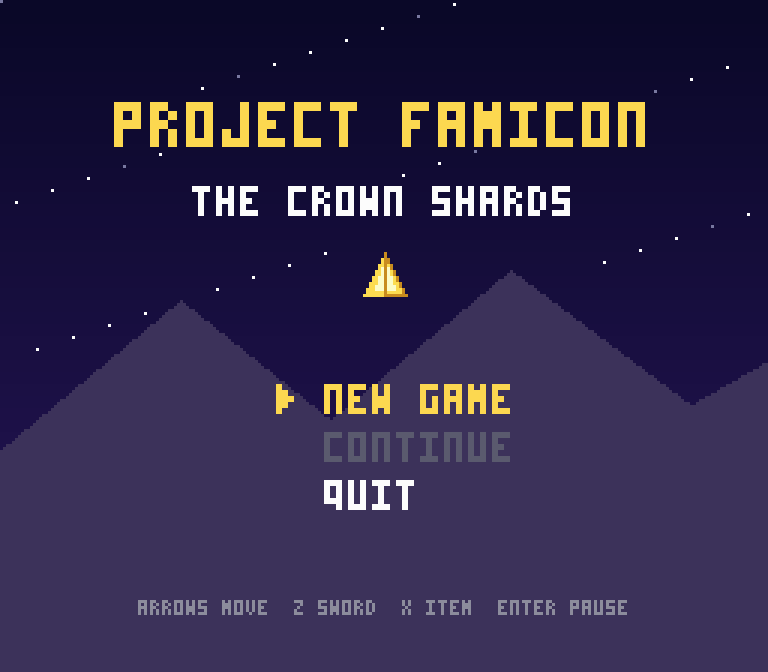
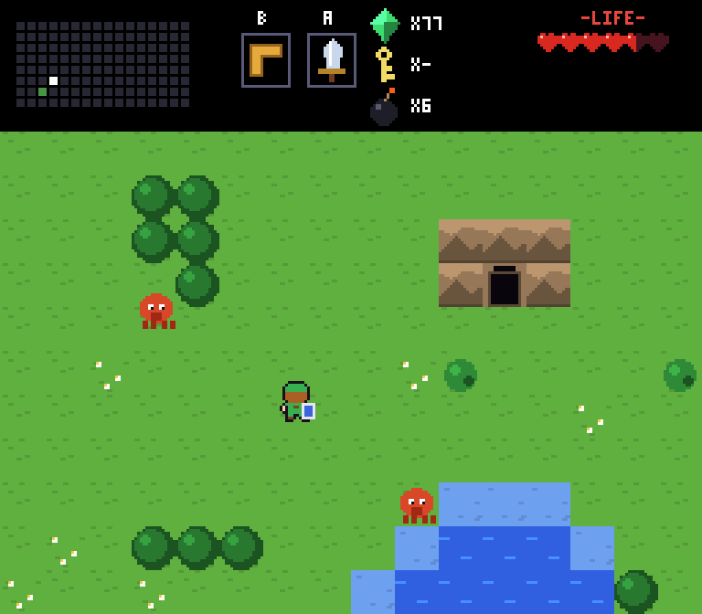
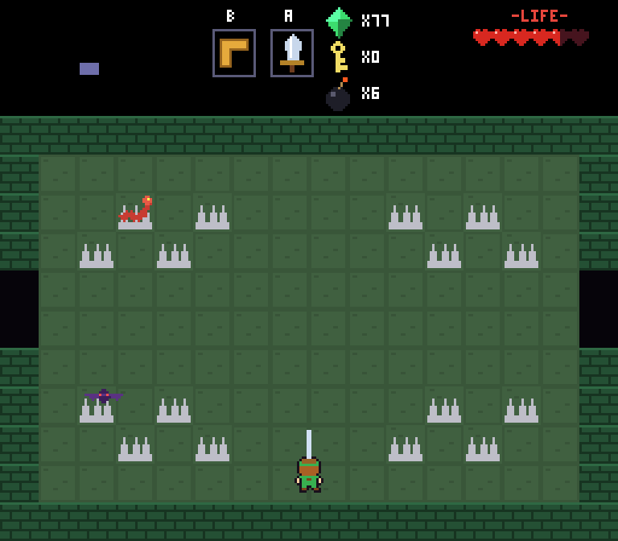
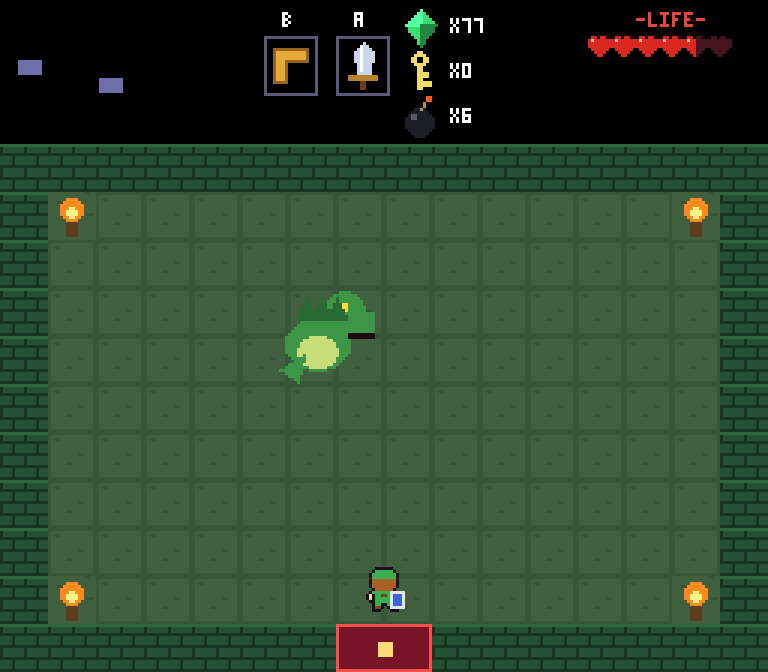
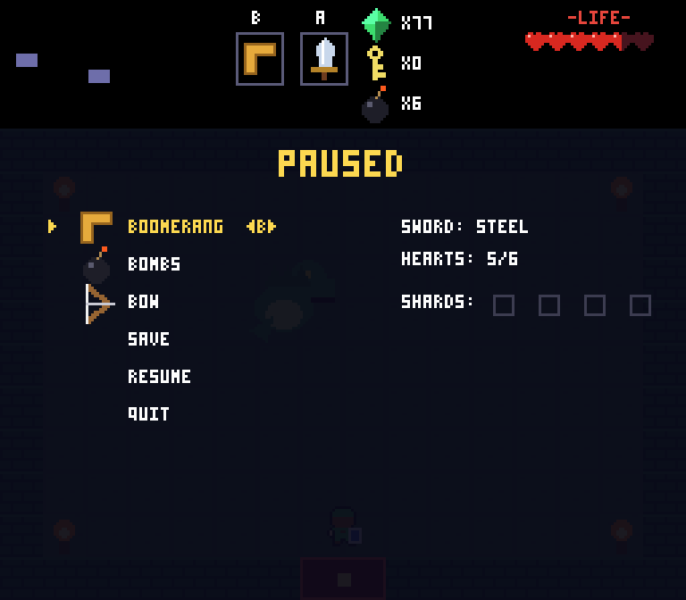
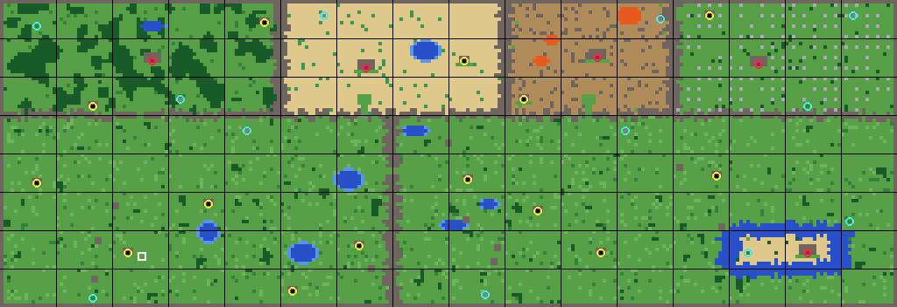

# Project Famicon: The Crown Shards

A top-down action-adventure in the spirit of the 8-bit classics, written in Python and pygame.
Explore a 16x8-screen overworld, find caves and secrets, clear five dungeons, and reassemble the Crown.

All code, art, names, text and music here are original and generated in code, so there are no asset
files to download or license.



| | |
|---|---|
|  |  |
|  |  |

*Previews rendered by the game's own renderer.*

## Run it

```bash
pip install -r requirements.txt
python main.py            # or: python -m famicon
python main.py --scale 4  # bigger window; --mute disables sound
```

Python 3.10+ and pygame 2.5+. Saves live in `~/.project_famicon/slot1.json`
(override with the `FAMICON_SAVE_DIR` environment variable).

## Controls

| Action | Keys |
|---|---|
| Move | Arrow keys / WASD |
| Sword | Z / J / Space |
| Use item | X / K / Left Shift |
| Pause, items, save | Enter / P / Esc |
| Fullscreen | F11 |

## How to play

- You start with nothing. Find the old man in the cave on the first screen.
- Hearts are life (a half-heart per hit). At full health your sword fires a beam.
- Your shield blocks rocks and arrows when you face them. Fire and magic ignore it.
- Cut bushes, bomb cracked rocks, and push boulders: many of them hide caves with hearts, gems and hints.
- Enemies drop gems, hearts and bombs. Shops sell bombs, potions, heart refills and the lantern.
- Each dungeon has a map, a compass, small keys, a boss key and one major item.
  Beat the boss for a heart container and a shard of the Crown.
- Four shards open the gate to the Crown Citadel. The way forward is gated by items:
  **bombs** open the eastern pass, the **power glove** moves boulders, **swim fins** cross deep water.

| Dungeon | Where | Reward | Boss |
|---|---|---|---|
| 1 Mossroot Hollow | Forest, northwest | Boomerang | Thornwyrm |
| 2 Gravewatch Crypt | Graveyard, northeast | Power glove | Tidecrab |
| 3 Sunscar Pyramid | Desert, north | Swim fins | Magmamaw (bombs only) |
| 4 Drowned Spire | Island, southeast | Bow | Frostwyrm |
| 5 Crown Citadel | Volcano, northeast | | The Warlock |

## The world



Yellow rings are caves, red are dungeons, cyan are secrets, the white square is the start.

The overworld and the dungeons are generated by scripts and committed as data, so they are reproducible
and reviewable:

```bash
python tools/worldgen.py --preview docs/overworld.png   # famicon/data/overworld.json
python tools/gen_dungeons.py                            # famicon/data/dungeons.json
```

`worldgen` carves the whole map as one big tile grid (so terrain is seamless across screens), places
gates, landmarks and secrets, and **verifies that every landmark is reachable only once you own the
right ability**. The dungeon generator puts locks on the path to the boss and keys in the part of the
dungeon you can reach before each lock, then proves the result can't soft-lock.

## Project layout

```
main.py                 entry point
famicon/
  game.py               game core: modes, rooms, scrolling, combat, items, save/load (no pygame)
  entities.py           player, projectiles, boomerang, bombs, pickups
  enemies.py            14 enemies and 5 bosses
  world.py              rooms, doors, overworld/dungeon/cave loading
  dungeon_gen.py        dungeon generator + solvability checker
  inventory.py          items and what they do
  assets.py             all art, drawn in code (tiles, sprites, bitmap font)
  render.py             drawing: world, HUD, menus, transitions
  audio.py              chiptune synth: sound effects and music
  app.py                pygame loop, input mapping, window scaling
  data/                 overworld.json, dungeons.json, interiors, room templates
tools/                  map and dungeon generators
tests/                  pytest suite (headless)
docs/                   architecture notes and screenshots
```

See [docs/ARCHITECTURE.md](docs/ARCHITECTURE.md) for how the pieces fit and how to add enemies, items and caves.

## Tests

```bash
pip install pytest
pytest
```

The core has no pygame dependency, so the suite plays the game headless: scrolling, caves, dungeons,
keys, bosses, secrets, saves, plus long random-input runs that must never crash.

## Roadmap

More dungeons and bosses, multiple save slots, a warp whistle, richer overworld set pieces, gamepad
support. Contributions welcome.

## License

MIT. See [LICENSE](LICENSE). This is an independent fan-style project and is not affiliated with or
endorsed by any game company.
